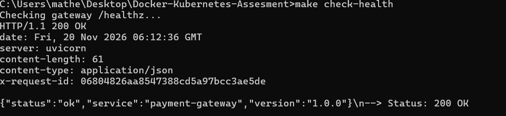
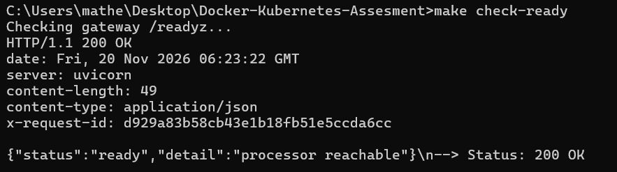
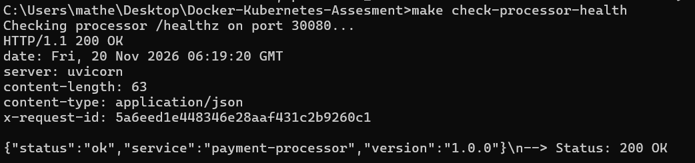
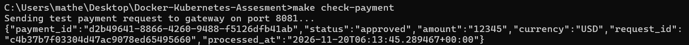
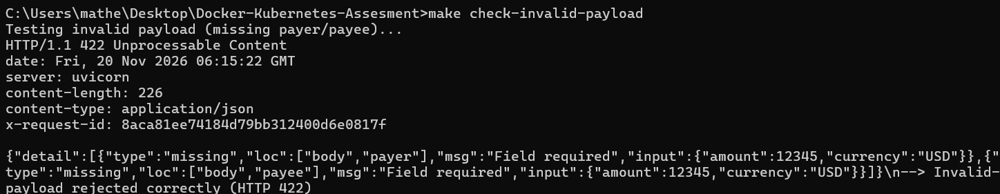
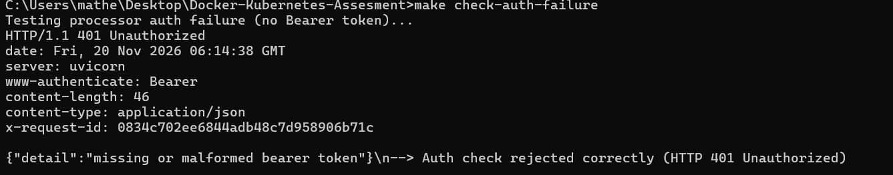

# Test Results & Verification

## 1. Gateway Health Check (`GET /healthz`)
- **Status:** PASS (HTTP 200)
- **Description:** Verifies that the payment gateway process is healthy.

**Make Command:**
```bash
make check-health
```

**Curl Command:**
```bash
curl -s http://localhost:8081/healthz
```

**Output:**
```json
{"status":"ok","service":"payment-gateway","version":"1.0.0"}
```



---

## 2. Gateway Readiness Check (`GET /readyz`)
- **Status:** PASS (HTTP 200)
- **Description:** Verifies the gateway can reach the downstream processor service.

**Make Command:**
```bash
make check-ready
```

**Curl Command:**
```bash
curl -s -o /dev/null -w "%{http_code}\n" http://localhost:8081/readyz
```

**Output:**
```
200
```



---

## 3. Processor Health Check (`GET /healthz`)
- **Status:** PASS (HTTP 200)
- **Description:** Verifies that the payment processor process is healthy.

**Make Command:**
```bash
make check-processor-health
```

**Curl Command:**
```bash
curl -s -o /dev/null -w "%{http_code}\n" http://localhost:30080/healthz
```

**Output:**
```
200
```



---

## 4. End-to-End Payment Flow - Success (`POST /pay`)
- **Status:** PASS (HTTP 200 - Approved)
- **Description:** Validates a payment request processed end-to-end through the gateway and processor.

**Make Command:**
```bash
make check-payment
```
*(or `make check-payment-success`)*

**Curl Command:**
```bash
curl -s -X POST http://localhost:8081/pay \
  -H "Content-Type: application/json" \
  -H "X-Service-Token: dev-shared-secret-change-me" \
  -d '{"amount":12345,"currency":"USD","payer":"acc-1","payee":"acc-2","cardNumber":"4111111111111111","expiry":"12/25","cvv":"123","reference":"test-01"}'
```

**Output:**
```json
{
  "payment_id": "c5d67537-fd7a-4484-b8cb-969b8903508c",
  "status": "approved",
  "amount": "12345",
  "currency": "USD",
  "request_id": "d7072a94008843a6b89808649e9cb860",
  "processed_at": "2026-11-20T05:38:10.254406+00:00"
}
```



---

## 5. Invalid Payload Validation (`POST /pay`)
- **Status:** PASS (HTTP 422 Unprocessable Entity)
- **Description:** Request with missing required fields (`payer`, `payee`) is properly rejected.

**Make Command:**
```bash
make check-invalid-payload
```

**Curl Command:**
```bash
curl -s -X POST http://localhost:8081/pay \
  -H "Content-Type: application/json" \
  -H "X-Service-Token: dev-shared-secret-change-me" \
  -d '{"amount":12345,"currency":"USD"}'
```

**Output:**
```json
{
  "detail": [
    {
      "type": "missing",
      "loc": ["body", "payer"],
      "msg": "Field required"
    },
    {
      "type": "missing",
      "loc": ["body", "payee"],
      "msg": "Field required"
    }
  ]
}
```



---

## 6. Processor Direct Call Without Authentication (`POST /process`)
- **Status:** PASS (HTTP 401 Unauthorized)
- **Description:** Direct call to processor without Bearer token is rejected.

**Make Command:**
```bash
make check-auth-failure
```

**Curl Command:**
```bash
curl -s -o /dev/null -w "%{http_code}\n" -X POST http://localhost:30080/process \
  -H "Content-Type: application/json" \
  -d '{"amount":12345,"currency":"USD","payer":"acc-1","payee":"acc-2","cardNumber":"4111111111111111","expiry":"12/25","cvv":"123","reference":"test-01"}'
```

**Output:**
```
401
```



---

## 7. Full Automated Test Suite (`make check-all`)
- **Status:** ALL PASS
- **Description:** Sequentially runs readiness wait, all health checks, happy-path payment, invalid payload test, and auth rejection test.

**Make Command:**
```bash
make check-all
```

**Output:**
```
$ make check-all
Waiting for gateway and processor pods to become Ready…
pod/payment-gateway-5b8b95756c-f8s5g condition met
pod/payment-processor-8874d9867-dz6qr condition met
Checking gateway /healthz...
OK
Checking gateway /readyz...
OK
Checking processor /healthz on port 30080...
OK
Running happy‑path payment request...
Payment succeeded
Testing invalid payload (missing payer/payee)...
Invalid-payload check OK (422)
Testing processor auth failure (no Bearer token)...
Auth-failure check OK (401)
All mandatory checks passed.
```